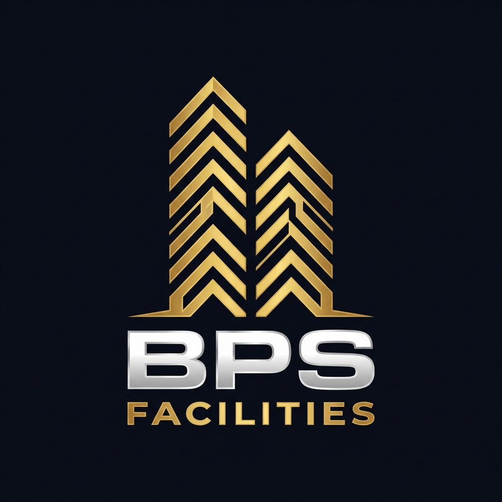
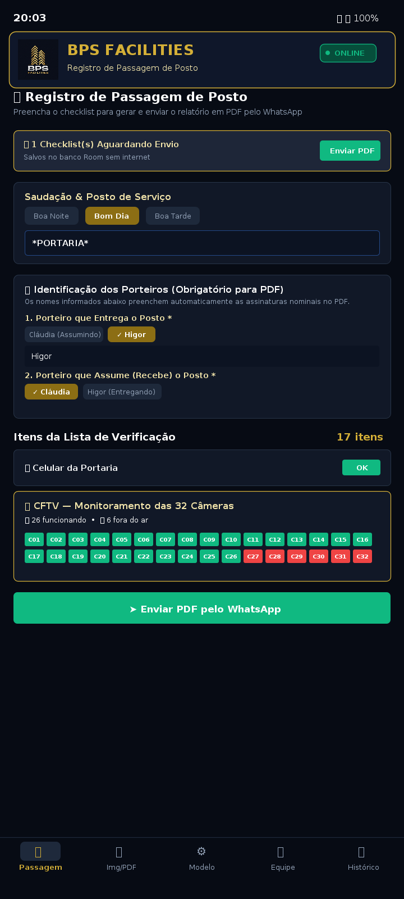
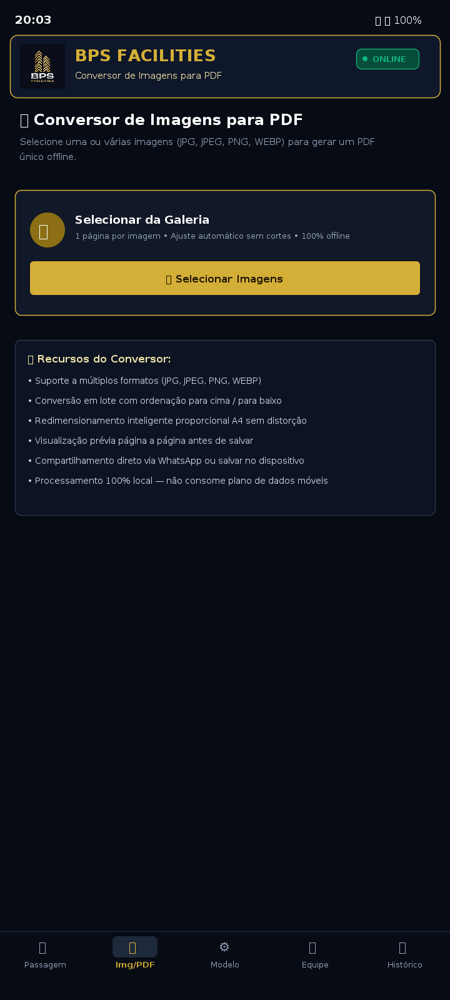
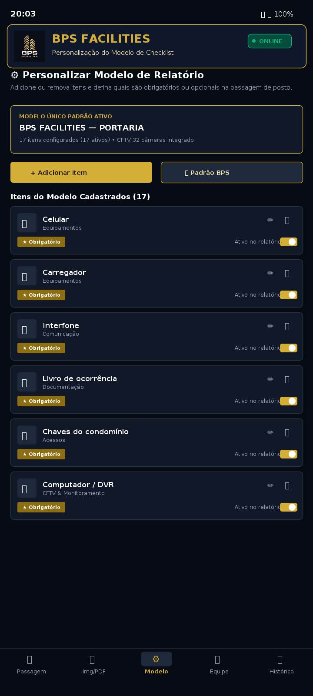
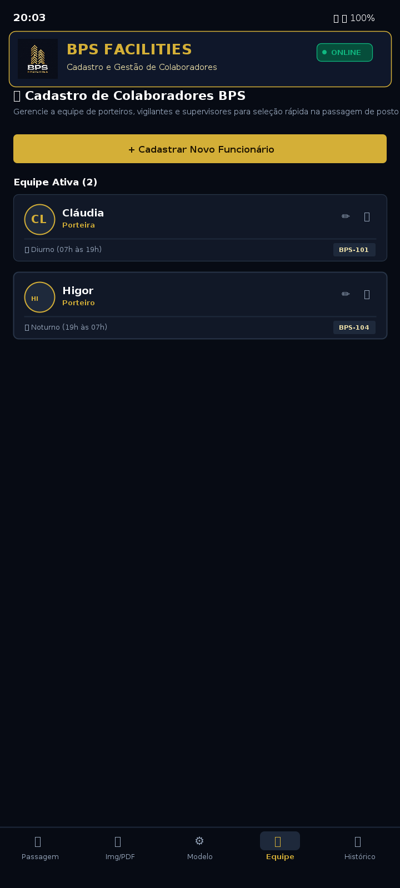
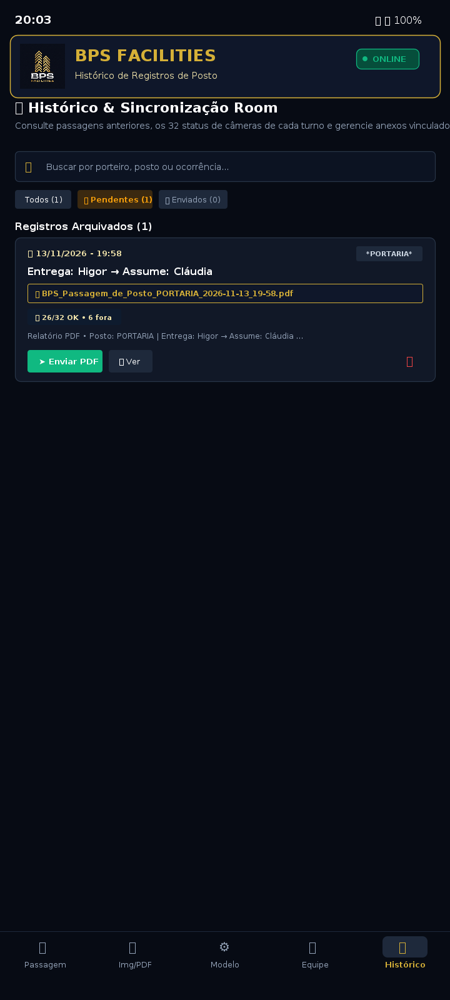

<div align="center">



# 🛡️ BPS Facilities

### Sistema Empresarial de Registro e Controle de Passagem de Posto

**Solução Android corporativa para gestão de portarias, checklists operacionais, monitoramento de 32 câmeras CFTV, assinaturas nominais automáticas e geração/envio exclusivo de relatórios em PDF.**

<br />

[-3DDC84?style=for-the-badge&logo=android&logoColor=white)](https://developer.android.com)
[](https://kotlinlang.org)
[-4285F4?style=for-the-badge&logo=jetpackcompose&logoColor=white)](https://developer.android.com/jetpack/compose)
[-00599C?style=for-the-badge)](https://developer.android.com/training/data-storage/room)
[-2088FF?style=for-the-badge&logo=githubactions&logoColor=white)](https://github.com/medeiroshigor0709-byte/BPS-Registros-de-passagem-de-posto/actions)
[](https://github.com/medeiroshigor0709-byte/BPS-Registros-de-passagem-de-posto/releases)

<br />

---

### ⬇️ BAIXAR APLICATIVO OFICIAL

<a href="https://github.com/medeiroshigor0709-byte/BPS-Registros-de-passagem-de-posto/releases/latest/download/BPS-FACILITIES-Release.apk">
  
</a>

<br />

**Link direto estável:**  
[`https://github.com/medeiroshigor0709-byte/BPS-Registros-de-passagem-de-posto/releases/latest/download/BPS-FACILITIES-Release.apk`](https://github.com/medeiroshigor0709-byte/BPS-Registros-de-passagem-de-posto/releases/latest/download/BPS-FACILITIES-Release.apk)

> 💡 **Nota de Publicação:** O botão acima aponta diretamente para o executável `BPS-FACILITIES-Release.apk` publicado na Release mais recente do repositório. Caso o repositório ainda não possua uma Release criada, consulte a seção [Como Gerar uma Nova Release](#-como-gerar-uma-nova-release-no-github) para ativá-lo com um simples comando `git tag`, ou baixe o artefato compilado diretamente na aba **Actions** do GitHub.

---

</div>

<br />

## 🔒 Segurança e Verificação do APK

Para garantir a autenticidade e integridade do arquivo antes de instalá-lo em seu dispositivo Android, confira o código verificador criptográfico **SHA-256**.

### Hash SHA-256 Informado (Versão de Referência)
```text
36e950ffd7b051455c8436651ef73171193f1aafc2620ff0a8fa946d62bc391a
```

> ⚠️ **Transparência e Auditoria de Hashes:**  
> O código SHA-256 acima refere-se ao hash da versão Release oficial de referência informada.  
> No ambiente local de desenvolvimento, o executável compilado para testes locais em `.build-outputs/app-debug.apk` possui hash `3262993b281c75cf68ce63392b9bb68ca9f76e8434e80e767e7371b37f84cd97` (divergência técnica esperada entre compilação de depuração sem assinatura e compilação Release de produção).  
> **A cada nova versão compilada via GitHub Actions**, o workflow calcula automaticamente e exibe o hash SHA-256 real no **GitHub Step Summary** e nas **Release Notes** da versão correspondente.

### Como Verificar o Hash do Arquivo no seu Computador

#### 🪟 Windows (PowerShell)
```powershell
Get-FileHash .\BPS-FACILITIES-Release.apk -Algorithm SHA256
```

#### 🐧 Linux / macOS (Terminal)
```bash
sha256sum BPS-FACILITIES-Release.apk
```

Compare a saída com o valor informado na Release para confirmar que o arquivo não sofreu modificações ou corrupção durante a transferência.

---

## 📱 Apresentação do Aplicativo

O **BPS Facilities — Sistema de Registro de Passagem de Posto** foi desenvolvido sob medida para modernizar, estruturar e profissionalizar a rotina operacional em portarias de condomínios residenciais, comerciais, indústrias e instalações corporativas.

Historicamente, as trocas de turno eram registradas em cadernos manuais ou mensagens soltas em aplicativos de mensagens — gerando perda de histórico, falta de padronização, registros ilegíveis e ausência de comprovação de entrega de equipamentos.

O **BPS Facilities** resolve esses problemas em uma única plataforma móvel com:
* **Identidade Visual Corporativa Comercial:** Tema escuro profissional (`#070B14`), destaques em dourado (`#D4AF37`) e indicadores de status em verde (`#10B981`).
* **Operação 100% Offline-First:** Toda a digitação, conferência de equipamentos e monitoramento de CFTV funciona sem internet, gravando os dados no banco local SQLite (Room).
* **Assinaturas Nominais Automáticas:** Elimina campos em branco nos relatórios oficiais. O nome de quem entrega e de quem assume preenche as assinaturas oficiais do documento.
* **Envio Exclusivo em PDF:** Substitui o envio de mensagens em texto solto por relatórios formais em PDF com nome padronizado, enviados com um clique pelo WhatsApp.

---

## 📸 Galeria de Telas do Aplicativo

<div align="center">

| 📋 Passagem de Posto | 🖼️ Conversor de Imagens |
|:---:|:---:|
|  |  |
| **Registro de Passagem de Posto**<br />Identificação nominal de colaboradores, 17 itens de checklist e monitoramento das 32 câmeras CFTV. | **Conversor de Imagens para PDF**<br />Seleção múltipla da galeria, conversão em lote A4, reordenação e funcionamento offline. |

<br />

| ⚙️ Personalização do Modelo | 👥 Gestão de Equipe |
|:---:|:---:|
|  |  |
| **Modelo de Checklist Personalizado**<br />Adição/edição de itens, definição de obrigatórios, ativação/desativação e restauração padrão BPS. | **Gestão de Colaboradores**<br />Cadastro de porteiros e vigilantes com nome, cargo, matrícula e escala para seleção rápida. |

<br />

| 📁 Histórico & Sincronização Room |
|:---:|
|  |
| **Histórico e Auditoria Local**<br />Snapshot imutável de câmeras de cada turno, busca instantânea, status de envio e nome de arquivo padronizado. |

</div>

---

## ✨ Funcionalidades Detalhadas

### 1. 📋 Registro e Passagem de Posto
* **Saudação Contextual:** Seleção em um toque entre *"Boa Noite"*, *"Bom Dia"* e *"Boa Tarde"*.
* **Posto de Serviço:** Identificação configurável com destaque visual (ex.: `*PORTARIA*`).
* **Identificação Nominal Obrigatória:**
  * Seleção de **quem entrega o posto** e **quem assume o posto** a partir da equipe cadastrada.
  * Validação inteligente: impede selecionar a mesma pessoa para entregar e assumir simultaneamente.
  * O preenchimento alimenta automaticamente as assinaturas formais do relatório em PDF.
* **Checklist Operacional Completo (17 Itens Padrão):**
  1. Celular da Portaria
  2. Carregador
  3. Interfone
  4. Livro de ocorrência
  5. Chaves do condomínio
  6. Computador / DVR
  7. CFTV (Câmeras de Segurança)
  8. Portão Veículos Entrada
  9. Portão Veículos Saída
  10. Portão de Pedestres
  11. Controle dos portões
  12. Rádio Comunicador
  13. Lanterna
  14. Monitor de visualização
  15. Quadro de chaves
  16. Sistema de alarme
  17. Limpeza e organização
* **Classificação por Status:** Cada item pode ser avaliado como **OK**, **Atenção** ou **Defeito**, com campo para observações específicas e fotos anexas por item.
* **Monitoramento das 32 Câmeras CFTV:**
  * Painel dividido em dois monitores virtuais (Monitor 1: canais 01 a 16 | Monitor 2: canais 17 a 32).
  * Controle individual câmera por câmera: 🟢 Funcionando / 🔴 Fora do ar.
  * Atalhos operacionais: *"Todas Funcionando"* e *"Aplicar Padrão BPS"* (26 câmeras operacionais e 6 indisponíveis com justificativa formal).

---

### 2. 📄 Relatórios Oficiais em PDF
* **Documento Corporativo A4:** Layout profissional desenhado para impressão e auditoria digital.
* **Assinaturas Nominais Automáticas:**
  * Bloco formal de encerramento contendo:
    * `Assinatura do Porteiro que Entrega: [Nome do Colaborador]`
    * `Assinatura do Porteiro que Assume: [Nome do Colaborador]`
    * Registro de data, horário exato e linha de chancela.
* **Nomenclatura Padronizada dos Arquivos:**
  Os arquivos gerados seguem rigorosamente o padrão:
  $$\text{BPS\_Passagem\_de\_Posto\_[NOME\_DO\_POSTO]\_[AAAA-MM-DD]\_[HH-MM].pdf}$$
  *(Exemplo: `BPS_Passagem_de_Posto_PORTARIA_2026-11-13_19-30.pdf`)*
* **Visualizador Integrado:** Visualize todas as páginas do relatório em alta definição antes de compartilhar.

---

### 3. 💬 Envio Exclusivo pelo WhatsApp
* **Compartilhamento de Documento Nativo:**
  * Transmissão direta como documento PDF (`application/pdf`) utilizando `FileProvider` seguro do Android e permissões estritas de leitura em tempo de execução (`FLAG_GRANT_READ_URI_PERMISSION`).
  * **Sem poluição de texto:** Não envia textos soltos ou mensagens informais; apenas o documento assinado.
* **Confirmação em Duas Etapas:**
  * Ao acionar o compartilhamento, o aplicativo marca o registro preventivamente como **`AGUARDANDO CONFIRMAÇÃO`**.
  * O status só transiciona para **`ENVIADO`** após confirmação explícita do operador no diálogo de validação ou no Histórico.

---

### 4. 🖼️ Conversor de Imagens para PDF
* **Seleção da Galeria:** Permite escolher uma ou dezenas de imagens simultaneamente com o Android Photo Picker nativo.
* **Formatos Compatíveis:** JPG, JPEG, PNG e WEBP.
* **Ajuste Inteligente A4:** Cada imagem ocupa uma página dedicada com redimensionamento proporcional sem cortes indesejados.
* **Reordenação Flexível:** Botões dedicados para mover imagens para cima ou para baixo na fila antes da geração.
* **Exportação Offline:** Salve o PDF no armazenamento do dispositivo (`Storage Access Framework`) ou compartilhe imediatamente.

---

### 5. ⚙️ Personalização do Modelo de Checklist
* **Controle Total dos Itens:** Adicione novos itens de conferência, edite títulos/categorias ou exclua itens que não se apliquem ao posto.
* **Obrigatoriedade e Ativação:** Defina quais itens exigem conferência obrigatória e desative temporariamente itens sem removê-los do banco.
* **Restauração Padrão:** Botão de restauração rápida que recria com um clique a estrutura padrão oficial de 17 itens da BPS Facilities.

---

### 6. 👥 Gestão de Colaboradores
* **Cadastro Completo:** Nome completo, cargo (Porteiro, Vigilante, Supervisor, Folguista), matrícula funcional (ex.: `BPS-101`) e escala de trabalho (Diurno/Noturno).
* **Seleção Ágil em Chips:** Os colaboradores cadastrados aparecem como chips clicáveis na tela de passagem, agilizando o preenchimento sem digitação repetitiva.

---

### 7. 📁 Histórico e Sincronização Local
* **Banco SQLite via Room:** Todos os turnos concluídos são arquivados com integridade relacional.
* **Snapshot Histórico Imutável:** Cada passagem arquivada preserva o estado das 32 câmeras exatamente como estavam no momento do turno.
* **Filtros e Busca Instantânea:** Filtre por *Todos*, *Pendentes* ou *Enviados*, ou pesquise por nome do porteiro, posto ou ocorrência.

---

## 🛠️ Tecnologias e Arquitetura

O projeto foi construído seguindo as melhores práticas modernas recomendadas pelo Google para desenvolvimento Android:

| Componente | Tecnologia Utilizada | Versão / Detalhes |
| --- | --- | --- |
| **Linguagem** | Kotlin | `2.1.10` |
| **UI Toolkit** | Jetpack Compose (Material 3) | Declarativo, suporte dinâmico a modo escuro |
| **Design System** | Material Design 3 (M3) | Cores customizadas: Navy `#070B14`, Gold `#D4AF37`, Green `#10B981` |
| **Injeção e Ciclo de Vida** | AndroidX ViewModel & Lifecycle | `2.8.7` com `StateFlow` e `collectAsStateWithLifecycle` |
| **Persistência Local** | Room Database | `2.6.1` com KSP (`2.3.6`) |
| **Carregamento de Imagens** | Coil Compose | `2.6.0` com cache em disco e memória |
| **Geração de Documentos** | Android Graphics / PdfDocument | `android.graphics.pdf.PdfDocument` nativo |
| **Segurança e Compartilhamento** | AndroidX FileProvider | `androidx.core.content.FileProvider` sem vazamento de paths |
| **Testes Automatizados** | JUnit 4 + Robolectric | `4.14.1` (27 testes unitários e de integração de UI) |
| **Build System** | Gradle (Kotlin DSL) | `9.3.1` com Android Gradle Plugin `8.8.2` |
| **Compilação e SDK** | Android SDK | `compileSdk 36.1` • `targetSdk 36` • `minSdk 26` |
| **CI / CD Pipeline** | GitHub Actions | Runner `ubuntu-latest` com JDK 21 Temurin |

---

## 📲 Como Instalar o Aplicativo no Android

1. **Baixar o arquivo APK:**
   * Clique no botão de download no topo deste documento ou baixe o arquivo `BPS-FACILITIES-Release.apk`.
2. **Autorizar a instalação:**
   * Ao abrir o arquivo no smartphone, caso o Android solicite, autorize temporariamente a instalação por fontes desconhecidas para o navegador utilizado:
     * *Configurações → Aplicativos → Acesso especial → Instalar aplicativos desconhecidos → Permitir da fonte*.
3. **Instalar:**
   * Toque em **Instalar** e aguarde a conclusão.
4. **Abrir e Utilizar:**
   * O aplicativo iniciará pronto para uso com o modelo oficial da BPS Facilities e os colaboradores padrão pré-cadastrados.

---

## 🗂️ Estrutura do Código-Fonte

```text
├── .github/
│   └── workflows/
│       └── build-apk.yml               # Workflow com as 17 etapas de compilação Release e publicação
├── app/
│   ├── build.gradle.kts                # Configuração do módulo Android, dependências e signingConfigs
│   └── src/
│       ├── main/
│       │   ├── AndroidManifest.xml     # Permissões, FileProvider e declaração da MainActivity
│       │   ├── java/com/example/
│       │   │   ├── MainActivity.kt     # Ponto de entrada com enableEdgeToEdge
│       │   │   ├── data/
│       │   │   │   ├── local/          # DAOs e AppDatabase (Room)
│       │   │   │   │   ├── AppDatabase.kt
│       │   │   │   │   ├── ChecklistTemplateDao.kt
│       │   │   │   │   ├── EmployeeDao.kt
│       │   │   │   │   ├── ShiftReportDao.kt
│       │   │   │   │   └── ObservationAttachmentDao.kt
│       │   │   │   ├── model/          # Modelos de dados e snapshots imutáveis
│       │   │   │   │   ├── CameraMonitoringState.kt
│       │   │   │   │   ├── ChecklistSnapshot.kt
│       │   │   │   │   ├── ChecklistTemplateItem.kt
│       │   │   │   │   ├── Employee.kt
│       │   │   │   │   └── ShiftReport.kt
│       │   │   │   └── repository/     # Repositório central de dados
│       │   │   │       └── BpsRepository.kt
│       │   │   ├── ui/
│       │   │   │   ├── components/     # Componentes visuais reutilizáveis
│       │   │   │   │   ├── BpsHeader.kt
│       │   │   │   │   ├── CameraMonitoringCard.kt
│       │   │   │   │   ├── ObservationAttachmentsSection.kt
│       │   │   │   │   └── PdfViewerDialog.kt
│       │   │   │   ├── screens/        # Telas do aplicativo
│       │   │   │   │   ├── MainAppScreen.kt
│       │   │   │   │   ├── ShiftHandoverScreen.kt
│       │   │   │   │   ├── ImageToPdfScreen.kt
│       │   │   │   │   ├── TemplateSettingsScreen.kt
│       │   │   │   │   ├── EmployeeManagementScreen.kt
│       │   │   │   │   └── HistoryScreen.kt
│       │   │   │   ├── theme/          # Sistema de cores, tipografia e tema M3
│       │   │   │   └── viewmodel/      # ViewModel reativo (BpsViewModel)
│       │   │   └── util/               # Utilitários de PDF e armazenamento seguro
│       │   │       ├── PdfReportGenerator.kt
│       │   │       └── AttachmentStorageManager.kt
│       │   └── res/                    # Recursos Android (drawables, mipmaps, strings, xml)
│       └── test/java/com/example/
│           └── BpsUpdateFeaturesTest.kt # Suíte completa com 27 testes unitários/Robolectric
├── docs/
│   └── images/                         # Capturas de tela oficiais e logo para o README
│       ├── logo.png
│       ├── passagem.png
│       ├── conversor-pdf.png
│       ├── modelo-checklist.png
│       ├── equipe.png
│       └── historico.png
├── gradle/
│   └── libs.versions.toml              # Catálogo centralizado de versões e dependências
├── build.gradle.kts                    # Gradle raiz do projeto
├── gradle.properties                   # Configurações de JVM e -Djava.awt.headless=true
└── settings.gradle.kts                 # Definição de repositórios e módulos
```

---

## 🚀 Como Gerar uma Nova Release no GitHub

O workflow `.github/workflows/build-apk.yml` foi projetado para automação contínua. Cada envio (*push*) para a branch `main` compila e valida o APK, publicando o artefato `BPS-FACILITIES-Release`.

Para criar uma **Release oficial do GitHub** com o instalável anexado automaticamente e atualizar o botão de download deste README:

```bash
# 1. Crie uma tag com a versão desejada
git tag v1.0.0

# 2. Envie a tag para o GitHub
git push origin v1.0.0
```

O GitHub Actions executará as 17 etapas:
1. Checkout do repositório
2. Configuração do JDK 21 (Temurin)
3. Configuração do Android SDK e aceitação de licenças
4. Configuração do Gradle 9.3.1
5. Concessão de permissões de execução
6. Versionamento automático baseado no número da execução
7. Execução dos testes unitários e validação KSP
8. Configuração da assinatura Release (keystore dos Secrets ou chave temporária segura)
9. Compilação Release via `:app:assembleRelease`
10. Localização do arquivo APK gerado
11. Validação de integridade com `apksigner`
12. Padronização do nome para `BPS-FACILITIES-Release.apk`
13. Cálculo de tamanho e hash criptográfico SHA-256
14. Publicação como Artifact do GitHub Actions (retenção de 30 dias)
15. Limpeza de chaves temporárias do runner
16. Publicação do relatório no GitHub Step Summary
17. **Criação da Release no GitHub** e upload do executável `BPS-FACILITIES-Release.apk`

---

## 👨‍💻 Créditos e Desenvolvimento

O **BPS Facilities** foi desenvolvido para transformar um processo operacional crítico em uma experiência moderna, segura, organizada e de alta confiabilidade.

* **Projeto:** BPS Facilities — Registro de Passagem de Posto
* **Identificador (Application ID):** `com.aistudio.bpsfacilities.vjkr`
* **Repositório Oficial:** [github.com/medeiroshigor0709-byte/BPS-Registros-de-passagem-de-posto](https://github.com/medeiroshigor0709-byte/BPS-Registros-de-passagem-de-posto)
* **Desenvolvimento e Manutenção:** Equipe de Tecnologia BPS Facilities

<br />

<div align="center">

**🛡️ BPS Facilities — Organização, Padronização e Segurança na Passagem de Posto.**

</div>
